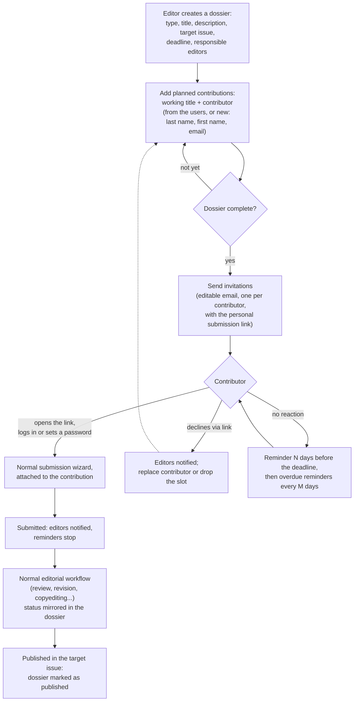
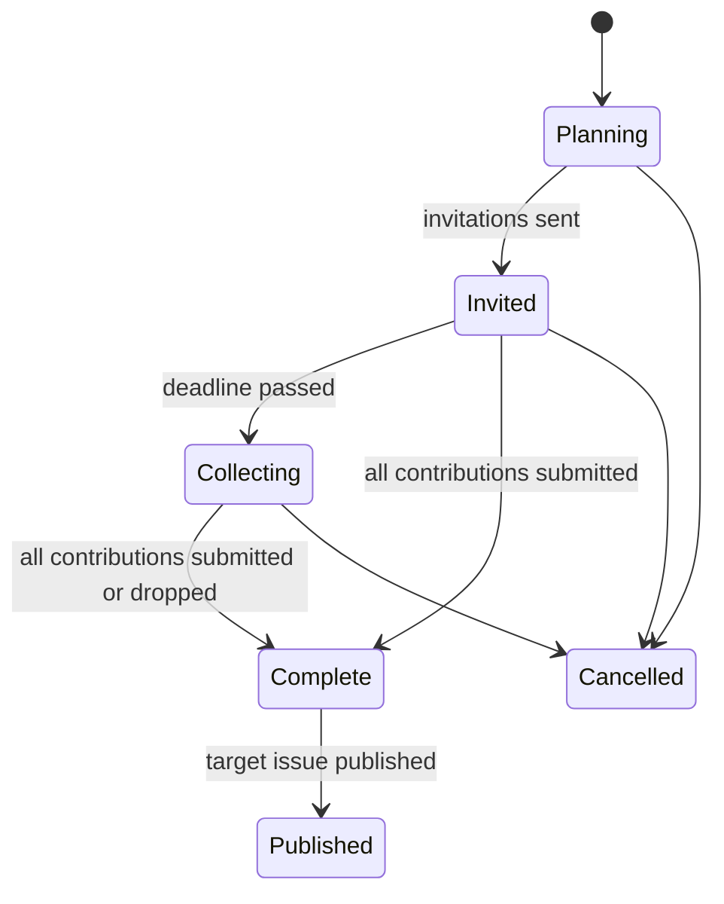

# Dossier Manager: planning special issues, thematic sections and symposia

Status: agreed (2026-11-22), see [Decisions](#decisions). Nothing is implemented yet.

## Goal

Journals often publish groups of articles that are planned and commissioned in advance: special issues, thematic sections, review symposia, forums, debates. Today the editors keep track of them in spreadsheets and email threads. Dossier Manager brings this planning into OJS 3.5:

- An editor plans a **dossier**: its title, description, target issue, submission deadline, and the **planned contributions** with their authors.
- The **responsible editors** of the dossier invite the contributors by email. Each contributor gets a **personal submission link**.
- A submission started from that link is an ordinary OJS submission, but it is attached to its planned contribution, so the editors see at a glance what has come in and what is missing.
- The plugin reminds contributors before the deadline and, after it, at regular intervals, until they submit.

## Name and vocabulary

**Plugin name:** *Dossier Manager* (folder `dossierManager`, repository `ojs-dossier-manager`, namespace `APP\plugins\generic\dossierManager`). The name parallels *Book Review Manager*, whose patterns this plugin reuses.

**Why "dossier":** the plugin needs one word for "any pre-planned group of articles". *Special issue* excludes sections and symposia; *collection* clashes with OJS categories and library usage; *bundle* is technical. *Dossier* is established in European humanities and social science journals for exactly this (fr. *dossier*, de. *Dossier/Schwerpunkt*, it./es. *dossier*), and covers a whole issue as well as a section. Each dossier has a **type** (special issue, thematic section, review symposium, forum, …) that is shown to people, so the word "dossier" mostly appears in the backend.

| Term | Meaning | OJS object |
| --- | --- | --- |
| **Dossier** | A planned group of commissioned articles to be published together | Plugin table `dm_dossiers` |
| **Dossier type** | What kind of dossier it is: *Special issue*, *Thematic section*, *Review symposium*, *Forum*, … The list is configurable; the label is used in emails | Plugin setting |
| **Target issue** | The future (unpublished) issue in which the dossier is to appear | `issue_id` |
| **Target section** | The journal section, chosen from the journal's sections, in which the contributions appear in the target issue (e.g. "Symposium", or "Articles" for a special issue) | `section_id` |
| **Responsible editors** | One or more editors who run the dossier and receive its notifications | Users with the journal editor role or the plugin's *Dossier editor* role |
| **Planned contribution** (short: *contribution*) | A slot in the dossier: a working title and its contributor | Plugin table `dm_contributions` |
| **Contributor** | The person who is to write a contribution. Co-authors are added by the contributor in the submission wizard, as usual | OJS user in the Author group |
| **Submission deadline** | The date by which contributions are due. A contribution can have an individual deadline (an extension) | Dossier setting, contribution setting |
| **Invitation** | The email to a contributor with the dossier details and the personal submission link | Mailable |
| **Submission link** | A contributor's personal link. It starts a normal OJS submission that is attached to the planned contribution | `dm_contributions.link_key` |
| **Reminder** | Automatic email before the deadline | Scheduled task |
| **Overdue reminder** | Automatic email after the deadline, repeated at an interval | Scheduled task |

## Roles and permissions

| Role | Can do |
| --- | --- |
| **Journal manager / journal editor** | Everything: create dossiers, be responsible editor of any dossier, see all dossiers, change the plugin settings |
| **Dossier editor** (plugin user group, base role *Section editor*) | Create dossiers, run the dossiers they are responsible for, see all dossiers (read-only for others' dossiers). Meant for section editors and for **guest editors** of a special issue, who can be given this role without journal-wide editor rights |
| **Contributor** | Receives emails and the submission link, submits, can decline through a link. Sees their open contributions under *My contributions* |

The *Dossier editor* group is created when the plugin is enabled (as `Roles` does in Book Review Manager). Managers can rename it under Users & Roles.

## The workflow

### 1. Creating a dossier

*Dossiers › Create new dossier* opens a form:

- **Type** (select, from the configured list), **title** and **description** (multilingual, rich text). The description is meant for the invitation email: what the dossier is about, the intended scope and length of the contributions.
- **Target issue**: a select of the journal's future issues. Optional while planning; required before invitations are sent (the issue is named in the email).
- **Target section**: a select of the journal's sections. Optional while planning; required before invitations are sent. Submissions attached to the dossier are put into this section.
- **Submission deadline** (date). Required before invitations are sent.
- **Responsible editors**: one or more users with the manager role or the *Dossier editor* role. The creator is preselected.
- **Guidelines link**: defaults to the journal's author guidelines page (`about/submissions`); can be overridden per dossier, e.g. with a style sheet for the symposium.
- **Notes** (internal, not sent to anyone).

### 2. Planned contributions

Each dossier has a list of planned contributions, which can be reordered (the order is used in the invitation email and can serve as the intended table of contents). Per contribution:

- **Working title** (optional, plain text): used in emails and the dossier overview, and as the proposed title of the submission.
- **Contributor**, either
  - chosen from the journal's users (search by name, email, affiliation), or
  - created ad hoc: **last name, first name, email**. This creates an OJS account in the journal's Author group with a random password and *must change password* set (as in Book Review Manager's invitation list). No email is sent until the invitation. If an account with this email exists, it is used.
- **Individual deadline** (optional): overrides the dossier's deadline, e.g. after an agreed extension.
- **Internal note**.

Contributions can be added, edited and removed at any time. Changing the contributor of an invited contribution invalidates the old submission link and offers to invite the new contributor.

### 3. Inviting contributors

When the dossier is complete, a responsible editor clicks **Send invitations**. A prefilled email opens, which can be edited once for all contributors; the personal parts are filled in per person when the emails are sent. Contributions added later are invited individually with **Invite** in their row; **Resend invitation** sends it again (e.g. when it got lost).

The invitation (`DOSSIER_INVITATION` mailable, editable under *Settings › Emails*) contains:

- the dossier's type, title and description;
- the target issue;
- the list of planned contributions (working titles and contributors' names, no email addresses);
- the link to the submission guidelines;
- the submission deadline (the contributor's individual one, if set);
- the contributor's **personal submission link**;
- a link to decline ("I cannot contribute after all"), optional (see open questions).

### 4. The submission link

The submission link is the core of the plugin.

- **Form:** `…/index.php/{journal}/dossier/submit/{key}`, with a random key per contribution.
- **Lookup:** the responsible editors see the link in the contribution's row (**Copy submission link**), so they can pass it on if the email is lost. Therefore the key is stored retrievably (not only as a hash, unlike Book Review Manager's one-click links). **Renew link** creates a new key and invalidates the old one.
- **The link is not a login.** Opening it shows a page with the dossier, the contribution and the deadline, and a button **Start your submission**. Opening the page changes nothing (mail scanners open links automatically; lesson from Book Review Manager).
  - Not logged in: the page asks the contributor to log in. For an account created ad hoc that has never been used, it offers **Set your password**, which sends OJS's password-reset email to the contributor's address.
  - Logged in as another user: the page says which account the link belongs to, and offers to log out. (Editors can reassign the contribution to the other account from the backend if the person uses two accounts.)
- **Starting the submission:** the button remembers the contribution in the session and leads to OJS's normal submission start page. When the submission is created (`Submission::add` hook), the plugin attaches it to the contribution, and:
  - sets the publication's section to the dossier's target section. The wizard does not offer a section choice for dossier submissions. The target section may be one that is closed to normal author submissions ("editors only"); the plugin allows it for dossier submissions;
  - **pre-assigns the submission to the target issue** (the publication's `issueId`). This only places it in the issue's list of scheduled content; publishing still needs the editors' usual *Schedule for publication*. If the dossier's target issue or section changes, the plugin moves the attached submissions that are not yet published, and records this in the history;
  - proposes the working title as the submission title, if the title is empty.
- **Inside the wizard:** under *For the Editors*, a section **Dossier** shows "This submission is your contribution to *{type} {title}*". A contributor who started a submission without the link can pick one of their open contributions there (fallback; same pattern as the "Reviewed works" section in Book Review Manager). The choice can be removed until the submission is completed.
- **After submission:** the link page says that the contribution has been submitted and links to the submission. A second submission for the same contribution is not possible through the link.

### 5. Reminders

A daily scheduled task (`HasTaskScheduler`, as `ReservationReminder` in Book Review Manager):

- **Reminder before the deadline:** sent N days before the contributor's deadline (default **7**), once, if the contribution has not been submitted.
- **Overdue reminders:** after the deadline, every M days (default **7**), while the contribution is not submitted.
- **Maximum number of overdue reminders** (default **4**, 0 = unlimited). After the last one, the responsible editors are notified and no further reminders are sent until they act (extend the deadline, send a personal message, or drop the contribution).
- An incomplete submission (wizard started, not finished) counts as not submitted; the reminder then says "please complete your submission" and links to it.
- **Pause reminders** per contribution, e.g. when an extension is being negotiated by email.
- Each reminder contains the submission link.

N, M and the maximum are journal settings and can be overridden per dossier.

### 6. Notifications to the responsible editors

The responsible editors receive an email (`DOSSIER_EDITOR_NOTIFICATION`, one template with an event-specific text) when:

- a contributor declines;
- a contribution is submitted (the wizard is completed);
- a contribution reaches the maximum number of overdue reminders;
- another editor changes the dossier (deadline, target issue, responsible editors) or its contributions (added, removed, contributor changed);
- a contribution's submission is declined or withdrawn in the editorial workflow;
- the target issue is published.

Changes an editor makes themselves are not mailed to that editor. Each editor can choose in their dossier settings to receive **every change immediately** or a **daily digest** (default: immediately for submissions and declines, digest for the rest; see open questions).

### 7. Tracking

**Dossier status:**

**Contribution status:**

| Status | Meaning |
| --- | --- |
| Planned | In the list, not invited yet |
| Invited | Invitation sent, nothing submitted |
| Declined | The contributor declined (by link or as recorded by an editor) |
| In progress | Submission started from the link, wizard not completed |
| Submitted | Submission completed; from here on, the OJS stage is shown (Submission, Review, Copyediting, Production) |
| Not accepted | The submission was declined in the editorial workflow |
| Published | Published |
| Dropped | Removed from the plan by the editors (kept for the history) |

Overdue contributions (Invited or In progress, deadline passed) are marked, with the number of reminders sent.

**History:** every step and every email is recorded in the dossier's history (OJS event log), as in Book Review Manager: "via email link", "automatically" (scheduled task), or by which editor.

## The backend menu

A section **Dossiers** in the left navigation menu, before *Settings* (pattern: `TemplateManager::setupBackendPage` in Book Review Manager):

- **My dossiers**: the dossiers the user is responsible for, with status, target issue, deadline and progress (e.g. "5 of 8 submitted, 2 overdue"). Managers can switch to **All dossiers**. Opening a dossier shows its contributions, actions and history.
- **Create new dossier**
- **Settings** (managers only): dossier types, reminder defaults, the "do not send emails" switch, notification defaults.

For contributors with open contributions, **My contributions** appears after *My Submissions* (pattern: "My book reviews"): dossier, working title, deadline, and the submission link or the submission.

## Settings

| Setting | Default |
| --- | --- |
| Dossier types | Special issue, Thematic section, Review symposium, Forum |
| Days before the deadline for the reminder | 7 |
| Interval of overdue reminders (days) | 7 |
| Maximum number of overdue reminders | 4 |
| Allow contributors to decline by link | yes |
| Do not send emails (for testing and setup) | off |

## Technical design

Reused from Book Review Manager (`cboulanger/ojs-book-review-manager`), adapted:

| Concern | Approach |
| --- | --- |
| Plugin class | `DossierManagerPlugin extends GenericPlugin implements HasTaskScheduler`, lazy-loaded |
| Tables | `dm_dossiers` (+ `dm_dossier_settings` for multilingual fields), `dm_dossier_editors`, `dm_contributions` (+ settings), `dm_links` for decline links. Migration class with `SCHEMA_VERSION`; the plugin upgrades its tables when it loads |
| Roles | `Roles` class: the *Dossier editor* group, created on enable, ID in a plugin setting |
| Backend pages | Page handler `dossiers` (lists, dossier page, settings); Vue/`pkp` components where OJS 3.5 provides them, Smarty otherwise |
| Submission link page | Public page handler `dossier/submit/{key}`; GET shows, POST acts |
| Decline link | One-click link as in `ActionLink`: hashed, expiring, single use, confirmation page |
| Linking submissions | Session + `Submission::add` hook; wizard section via `Template::SubmissionWizard::Section` and the `steps` state; completion via the submission-submitted hook/event |
| Editorial status | Read from the submission (stage, status); `Publication::publish` and issue publication hooks for *Published* |
| Issue and section | Set on the publication (`issueId`, `sectionId`) when the submission is attached; updated when the dossier's target changes. Needs a check how OJS 3.5 handles an `issueId` on an unscheduled publication in the issue's TOC and in *Schedule for publication*, and whether a section closed to authors can be set through the wizard |
| Emails | Mailables in `mailables/`, templates in `emailTemplates.xml` and `locale/*/emails.po`; editable before sending where an editor sends them |
| Scheduled task | `DossierReminder`, daily |
| Audit trail | OJS event log on the dossier |
| Locales | English and German only |
| Dev setup | `dev/` container (Podman/Docker, OJS 3.5 test journal with accounts for each role), `tests/run.sh` with PHPUnit and API/E2E suites, release workflow with `.gitattributes export-ignore`, as in Book Review Manager |

Not used: OJS's own Invitation framework, for the reasons recorded in Book Review Manager's `ActionLink` (it deletes other pending invitations of the same type for the same person, acts on GET, and knows only accept/decline).

## Out of scope for the first version

- A public page or call for papers for the dossier.
- Proposals/abstracts before the full submission (a two-stage "abstract first" workflow).
- Ordering the issue's table of contents from the dossier.
- A REST API and import of dossiers already under way.
- Guest editors handling the editorial workflow of the contributions (they can be assigned as editors of the submissions in OJS as usual).

## Decisions

| # | Question | Decision |
| --- | --- | --- |
| 1 | Name | *Dossier Manager* |
| 2 | Who may create dossiers | Journal managers/editors and the *Dossier editor* role (e.g. guest editors) |
| 3 | Contributors per contribution | One; co-authors are added in the submission wizard |
| 4 | Must the target issue exist when the dossier is created? | No; the target issue and section are required before invitations are sent |
| 5 | Issue assignment of submitted contributions | **Pre-assigned** to the target issue, in the dossier's target section (chosen from the journal's sections). Publication still needs the editors' *Schedule for publication* |
| 6 | Decline link in the invitation | Yes, configurable |
| 7 | Change notifications | Per editor: immediately or daily digest; default immediately for submissions and declines, digest for the rest |
| 8 | Overdue reminders | At most 4 by default (configurable, 0 = unlimited), then the responsible editors are notified |
| 9 | Other contributors' names in the invitation | Yes, with a per-dossier switch |
| 10 | Locales | English and German only |
